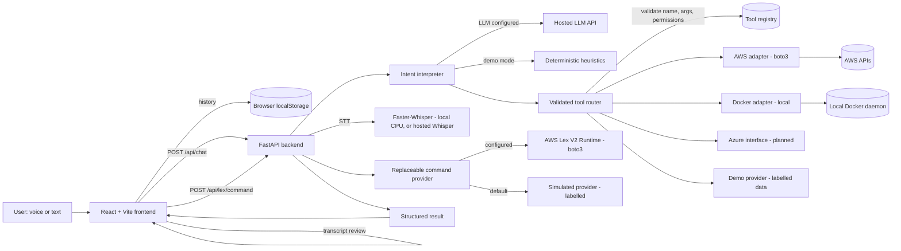
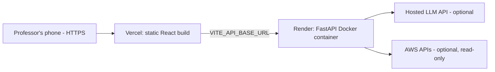

# Synthia

> **Speak to your infrastructure.**

Synthia is a cloud-hosted, voice-enabled AI assistant for cloud operations. It
handles general questions, transcribes speech, interprets natural-language
requests against a **validated tool router**, and can inspect real
infrastructure through replaceable provider adapters (AWS, Docker, Azure).
Every speech-recognition attempt — successful or failed — is recorded in a
first-class **Transcription History** for debugging.

This is a Cloud Computing mini-project. It relies on hosted services, a
remotely deployed API, containerised deployment, provider SDKs, API-based
infrastructure operations, identity/permissions, and a modular multi-cloud
architecture.

- **Repository:** synthia
- **Frontend:** React + Vite + TypeScript
- **Backend:** Python + FastAPI
- **Packaging:** Docker + Docker Compose
- **CI:** GitHub Actions
- **Design:** retro-blue operator console — see [`DESIGN.md`](DESIGN.md)

---

## 1. Project overview

Synthia lets a user speak or type a request. Voice input is transcribed by a
**local Faster-Whisper model on the backend** (CPU/INT8 by default), a hosted
Whisper-compatible API, or the browser Web Speech API. The transcript is
shown **exactly as recognised** so the user can debug misheard commands and
resubmit an edited version. The backend interprets the request with an LLM
(or a deterministic heuristic in demo mode), decides whether it is general
conversation, a cloud explanation, a read-only operation, or a mutating
operation, and — for real operations — routes it through a permission-aware
tool registry. Provider adapters (AWS, Docker, Azure) execute only pre-defined,
validated operations. The LLM never gets shell access or unrestricted control.

## 2. Problem statement

Managing cloud infrastructure normally means remembering CLIs, SDKs, regions,
identifiers, and provider-specific APIs. Natural-language interfaces lower that
barrier, but they introduce two risks:

1. **Misheard commands** — speech recognition is imperfect, and acting on a
   wrong transcript can be destructive.
2. **Unsafe model output** — an LLM must not be allowed to run arbitrary
   commands or mutate infrastructure on a hunch.

Synthia addresses both: it exposes the raw transcript for review, keeps a
debuggable history of every attempt, and constrains all real actions behind a
validated, read-only-by-default tool router.

## 3. Objectives

- Provide a working end-to-end voice/text assistant for cloud operations.
- Make speech recognition failures **visible and diagnosable**, not generic.
- Route natural language through a **validated, permission-aware** tool registry.
- Integrate at least one **real** cloud provider (AWS) and one local provider
  (Docker), with an extensible interface for more.
- Run entirely in **demo mode** without paid credentials.
- Package with Docker and document public deployment (Vercel + a Docker host).
- Be usable from a phone browser over HTTPS.

## 4. Cloud computing concepts used

- **Hosted services** — the LLM and (optional) speech-to-text are network APIs.
- **Remotely deployed API** — FastAPI runs as a container on a cloud host.
- **Containerisation** — Docker images for backend (and optionally frontend).
- **Provider SDKs** — boto3 (AWS), Docker SDK for Python, Azure SDK interface.
- **API-based infrastructure operations** — resources are read via cloud APIs.
- **Identity & permissions** — the AWS credential chain, read-only IAM,
  least privilege, and bearer-token gating of real infrastructure endpoints.
- **Modular multi-cloud architecture** — provider adapters and a tool registry
  decouple the assistant from any single cloud.
- **Environment-based configuration** — twelve-factor style config and secrets.

## 5. Architecture



Request flow:

> User voice/text → speech transcription (when applicable) → transcript
> inspection → LLM interpretation → validated tool router → authorised provider
> API → structured result → assistant response **and** history.

## 6. Frontend / backend responsibilities

**Frontend (`frontend/`)**

- Conversation interface with visible current transcript.
- Voice recording lifecycle (listening / processing / success / error).
- Transcription History: search, filters, detail, copy, retry, edit+resubmit,
  clear, empty state.
- Cloud provider status and a live tool runner.
- **Voice Commands** page: a replaceable intent recogniser (AWS Lex V2 or a
  labelled simulated provider) with transcript, intent, slots, latency, and a
  clear live-vs-simulated distinction.
- Optional **"Synthia" wake word** (off by default) that arms the recorder.
- Settings: language, recogniser, wake word, privacy, demo indicator.
- Mobile bottom navigation and responsive layout.
- **Owns V1 history** in browser `localStorage`.

**Backend (`backend/`)**

- General assistant API and streaming endpoint.
- Optional server-side STT endpoint.
- Replaceable LLM provider integration.
- Optional, replaceable voice-command provider (AWS Lex V2 or simulated).
- Intent interpretation and validated tool routing.
- Provider adapters and a permission-aware tool registry.
- Authentication for sensitive endpoints, rate limiting, structured errors.
- Health/readiness endpoints.

## 7. Speech-recognition flow

1. The user taps the microphone (microphone permission is requested **only**
   after this interaction).
2. A provider from the `SttProvider` interface is used:
   - `server` (**default**) — records audio with `MediaRecorder` and posts it to
     `POST /api/stt/transcribe`. The backend transcribes it with **local
     Faster-Whisper** (the default `STT_PROVIDER=faster-whisper`) or an optional
     hosted Whisper-compatible endpoint. Audio leaves the browser but, with
     Faster-Whisper, stays on your backend host.
   - `browser` — Web Speech API. Some browsers send audio to a vendor service and
     it frequently fails with a network error; kept as an alternative.
3. Statuses are distinct and never collapsed: `success`, `empty_transcript`,
   `permission_denied`, `unsupported_browser`, `network_failure`,
   `provider_error`, `timeout`.
4. The recognised text is displayed **verbatim** in a review strip. The user
   reviews/edits and presses send — Synthia does not silently correct a misheard
   transcript.
5. Typed input is always available and is labelled as `typed`, not as speech.

### Optional wake word ("Synthia")

Wake-word mode lets a user start recording by saying **"Synthia"** instead of
tapping the microphone. It is deliberately **off by default** and is a
convenience layered on top of the manual recorder, never a replacement:

- **Keyword spotting only.** The phrase is detected with the browser Web Speech
  API. Real transcription still goes through the configured STT provider
  (server-side Faster-Whisper by default) — the wake word never sends a request
  by itself.
- **Privacy is explicit.** Many browsers (Chrome included) send microphone audio
  to the browser vendor to recognise speech, so wake mode is **not an offline
  feature**. This is disclosed in Settings and the wake status bar. Audio only
  leaves the device while wake mode is armed or recording.
- **The microphone is shared, not fought over.** Detection pauses while the
  request recorder is active and is re-armed afterwards; at most one session
  ever holds the mic. Hitting detect immediately releases the mic before
  recording starts.
- **You still review.** A detected wake word only starts listening — the
  transcript is shown for review and is never auto-submitted.
- **Easy to stop.** The wake status bar exposes a single "turn off" control that
  disables detection and stops any recording. Turning the setting off also tears
  the session down on unmount. Supported states are `disabled`, `unsupported`,
  `waiting`, `detected`, `recording`, `processing` and `error`.
- **Failure is handled.** Permission denial, unsupported browsers, network loss,
  and empty speech each surface a clear status and fall back to the always-
  available microphone button and typed input.

## 8. Transcription debugging & history

Each attempt records: unique event id, timestamp, exact transcript, provider,
language, input source, recognition status, confidence (only when the provider
genuinely supplies it), parsed intent, selected tool, tool status, safe error
details, and duration.

The History page provides search, all/success/failed filters, an event detail
view, copy, retry, edit-and-resubmit, clear, and an empty state. History is
stored in `localStorage` and is explicitly **local to the browser/device — it
does not synchronise across devices**. Raw audio, credentials, authorization
headers, and sensitive cloud responses are **not** stored.

## 9. LLM intent interpretation

- Configured via environment variables and replaceable
  (`LLM_PROVIDER`, `LLM_API_KEY`, `LLM_MODEL`, `LLM_BASE_URL`). Any
  OpenAI-compatible endpoint works.
- When a structured LLM is configured, it receives the tool catalogue and must
  return JSON: `{operation, tool, arguments, answer}`. Its output is advisory.
- When no key is configured, Synthia uses a **deterministic heuristic**
  interpreter and an offline demo knowledge base, so the app is fully usable in
  demo mode.
- The LLM never executes anything. It cannot claim an action succeeded; only
  the backend's tool execution result is trustworthy.

## 10. Cloud tool router & provider adapters

Every tool has a name, description, JSON argument schema, required permissions,
provider, read-only/mutating classification, and an execution function.

The backend independently rejects: unknown tools, invalid arguments (Pydantic,
extra keys forbidden), unavailable providers, unauthorised requests, and
out-of-scope operations. Handlers are the only code that runs.

| Provider | Status | Notes |
| --- | --- | --- |
| **AWS** (boto3) | Implemented, unit-tested with mocks | Read-only: list/describe EC2, list S3. Live use requires credentials. |
| **Docker** (SDK) | Implemented, unit-tested with mocks | Read-only: list/inspect containers, bounded logs. Local only; disabled in production. |
| **Azure** | Interface + config only | Reported honestly as planned/unconfigured. No live operations. |
| **Demo** | Implemented & verified | Labelled sample data; never a real mutation. |

## 11. Optional voice-command mode (AWS Lex V2, replaceable)

Synthia can recognise the **intent** and **slots** of a voice command (for
example `DeviceControlIntent` with `Action=turn_on`, `Device=fan`,
`Room=bedroom`). This is optional and independent of the assistant and STT
flows: with no configuration the app still works.

- **Replaceable contract.** The backend depends only on a small `LexProvider`
  interface (`recognize_text`, optional `recognize_utterance`, `health`), the
  same way STT and the LLM are abstracted. AWS Lex is one implementation; a
  local rule-based provider (the default) is another.
- **AWS Lex V2 adapter (boto3).** Configured with `LEX_ENABLED=true`,
  `LEX_BOT_ID`, `LEX_BOT_ALIAS_ID` (default `TSTALIASID`), `LEX_LOCALE_ID`, and
  `AWS_DEFAULT_REGION`. Credentials come from the standard AWS chain (IAM role,
  shared config, or environment) — never hardcoded or logged. It calls
  `RecognizeText`; `RecognizeUtterance` is used only when
  `LEX_USE_RECOGNIZE_UTTERANCE=true`, because that path requires **raw 16 kHz
  mono PCM** (a WAV header is stripped automatically). Arbitrary browser audio
  formats are **not** assumed to work.
- **You do not duplicate Lambda fulfilment.** Synthia never reimplements the
  bot's fulfilment logic. Configure a **Lambda code hook** on the Lex bot
  yourself; Synthia only parses the stable fields it needs. The AWS bot, alias,
  and Lambda are **not created or verified by this project**.
- **The portable path is STT → `RecognizeText`.** Audio capture and
  speech-to-text stay separate: the frontend transcribes with the configured
  STT provider and sends the resulting **transcript** to Lex. This is also the
  path to a future custom intent recogniser.
- **Status is honest.** The Commands page shows whether the provider is
  **live**, **simulated**, or **disabled**, with the reason and a setup hint.
  `/ready` reports `lex` alongside `llm` and `stt`.

### Safety

- **Untrusted input.** Lex intents and slots are validated against explicit
  allowlists. Unknown intents collapse to `FallbackIntent`; unknown slots are
  dropped; slot values are bounded. A misconfigured bot cannot inject arbitrary
  keys or values.
- **Distinct sessions.** Every caller supplies (or is issued) its own session
  id; there is no shared hardcoded session.
- **No hidden actions.** The recogniser returns intent, slots, and a message —
  it does **not** execute infrastructure operations and cannot bypass the
  validated tool router, auth, or confirmation controls.
- **Live vs simulated is explicit.** Simulated results are labelled
  `DEMO DATA` in the API and the UI; they are never presented as live AWS
  responses. No raw audio, transcripts beyond the response, or credentials are
  logged.

### Replacement path (no model training)

The recognition stack is swappable piece by piece, each behind the same
contract:

1. **Speech** — a custom STT implements the existing STT contract and returns a
   transcript.
2. **Intent** — the transcript goes to AWS Lex `RecognizeText` now; a custom
   intent recogniser can later replace Lex behind the same app-level contract.
3. **Fulfilment / TTS** — a custom fulfilment function (or Polly alternative)
   can replace the Lex Lambda independently.

Building a flow around an existing model or service is **not** the same as
training one, and Synthia does not claim to train models.

## 12. Docker packaging

- `backend/Dockerfile` — Python 3.13 slim, non-root, binds `0.0.0.0`, honours
  `$PORT`, includes a healthcheck.
- `frontend/Dockerfile` — multi-stage Node build → nginx, with SPA fallback.
- `compose.yaml` — runs both with `docker compose up --build`.

## 13. Deployment architecture



- **Frontend → Vercel.** Set `VITE_API_BASE_URL` to the backend URL in Vercel's
  build settings. No `localhost` is hardcoded in production code.
- **Backend → Render (or any Docker host).** The image binds `0.0.0.0`, respects
  `PORT`, and reads all config from environment variables.
- **CORS** is restricted to configured origins via `CORS_ALLOWED_ORIGINS`.

> Free hosting may sleep, restart, or rate-limit. Do not assume always-on or
> unlimited free infrastructure.

## 14. Security & limitations

**Implemented**

- Read-only cloud tools by default (`ALLOW_MUTATING=false`).
- Mutating tools require both `ALLOW_MUTATING=true` and explicit confirmation.
- Bearer-token gating of cloud execution and server history when
  `API_AUTH_TOKEN` is set.
- No arbitrary shell execution; the LLM cannot run commands.
- Docker access disabled in production environments.
- Structured error responses that never leak stack traces or secrets.
- Simple in-memory rate limiting; request size/length limits.
- No secrets in the frontend; only connection *status* is exposed.

**Verified vs. requires credentials**

| Feature | Verified | Requires credentials/config |
| --- | --- | --- |
| Demo mode, tool routing, history, tests | ✅ | — |
| LLM answers | Demo only | Hosted LLM key for live answers |
| Local Faster-Whisper STT | Verified end-to-end (CPU/INT8, incl. WebM) | `STT_PROVIDER=faster-whisper`; first run downloads the model |
| Browser speech recognition | Implemented | A supported browser + HTTPS |
| Hosted STT | Implemented | `STT_PROVIDER=openai` + key |
| AWS read-only ops | Mocks + unit tests | AWS credentials (read-only) |
| Lex voice commands | Simulated provider verified; AWS adapter mocked (no real AWS) | A Lex V2 bot + alias + Lambda, AWS credentials, `LEX_*` config |
| Docker read-only ops | Mocks + unit tests | Local Docker daemon |
| Azure | Interface only | Not implemented |

**Known limitations (not claimed)**

- No Kubernetes orchestration, high availability, or cloud-native autoscaling.
- Not a working multi-cloud control plane: only AWS and Docker are real; Azure
  is an interface.
- In-memory server history is ephemeral and non-authoritative.
- Rate limiting is per-instance, not distributed.
- Browser speech recognition behaviour varies across browsers and is not
  promised to work identically on all mobile browsers.

## 15. Installation & local execution

### Backend

```bash
cd backend
python3 -m venv .venv
source .venv/bin/activate
pip install -r requirements-dev.txt
cp ../.env.example .env          # optional; defaults run in demo mode
uvicorn app.main:app --reload --port 8000
```

Open `http://localhost:8000/docs` for the OpenAPI docs.

### Frontend

```bash
cd frontend
npm install
cp .env.example .env             # optional; empty API base uses the dev proxy
npm run dev                      # http://localhost:5173
```

The Vite dev server proxies `/api`, `/health`, and `/ready` to
`http://localhost:8000` (override with `VITE_DEV_BACKEND`).

### Local Faster-Whisper speech-to-text (default)

This is the recommended recogniser: it runs on the backend host with no API key
and no GPU.

```bash
# backend/.env
STT_PROVIDER=faster-whisper
STT_MODEL=base          # tiny | base | small | medium | large-v3
STT_DEVICE=cpu          # cpu by default; cuda works if you have CUDA
STT_COMPUTE_TYPE=int8   # int8 for CPU; float16 for a GPU
# STT_CACHE_DIR=/home/you/.cache/synthia   # model cache; kept out of the repo
```

- **First run needs internet.** The model is downloaded once, then cached and
  reused for the process lifetime (it is never reloaded per request and is
  **not** downloaded during a Docker build). If the download fails you get a
  clear "could not load the local speech model" error.
- **Model size vs. CPU/RAM (rough, INT8, 1–2 sentence clips on an i7-class CPU):**

  | Model | Disk | RAM | Speed | Accuracy |
  | --- | --- | --- | --- | --- |
  | `tiny` | ~75 MB | ~0.5 GB | fastest (near real time) | basic |
  | `base` | ~145 MB | ~0.7 GB | fast | good default |
  | `small` | ~485 MB | ~1.2 GB | ~2–3× slower than base | better |

  Start with `base`; drop to `tiny` if you need maximum speed, or move to
  `small` if accuracy matters more than latency. 20 GB RAM is far more than
  enough for any of these on CPU.
- **Audio formats:** browser recordings are WebM/Opus; the decoder (PyAV/FFmpeg)
  also handles WAV, MP3, OGG, FLAC and M4A.
- **Authentication & limits:** the endpoint respects `API_AUTH_TOKEN` and
  `STT_MAX_UPLOAD_BYTES` exactly like the hosted provider.
- A failed local transcription **returns a real error** — Synthia never silently
  falls back to browser recognition.

**Docker Compose** passes the same settings and persists the model in a named
volume, so it survives rebuilds:

```bash
STT_PROVIDER=faster-whisper STT_MODEL=base docker compose up --build
# First transcription downloads the model into the `synthia-models` volume.
```

**Deploying to Vercel:** local Faster-Whisper runs on whatever **backend host**
you deploy (e.g. Render), not on Vercel. Vercel only serves the static frontend.
A public Vercel site does **not** automatically get your laptop's local model —
point `VITE_API_BASE_URL` at a backend that has Faster-Whisper installed, and
note that free hosts may not have the CPU/RAM or persistent disk for it.

## 16. Environment variables

See `.env.example` (backend) and `frontend/.env.example`. Key variables:

| Variable | Purpose |
| --- | --- |
| `APP_ENV`, `PORT`, `DEMO_MODE` | Runtime basics |
| `CORS_ALLOWED_ORIGINS` | Allowed frontend origins |
| `API_AUTH_TOKEN` | Bearer token for protected cloud operations |
| `ALLOW_MUTATING` | Opt in to mutating tools (default false) |
| `RATE_LIMIT_PER_MINUTE` | Per-instance rate limit |
| `LLM_PROVIDER`, `LLM_API_KEY`, `LLM_MODEL`, `LLM_BASE_URL` | LLM configuration |
| `STT_PROVIDER` (`none`\|`faster-whisper`\|`openai`) | Server STT selection (default `faster-whisper`) |
| `STT_MODEL`, `STT_BASE_URL`, `STT_API_KEY` | STT model / hosted endpoint / key |
| `STT_DEVICE`, `STT_COMPUTE_TYPE`, `STT_CACHE_DIR` | Local Faster-Whisper (CPU/INT8 default) |
| `AWS_ENABLED`, `AWS_DEFAULT_REGION`, `AWS_ACCESS_KEY_ID`, `AWS_SECRET_ACCESS_KEY` | AWS |
| `LEX_ENABLED`, `LEX_BOT_ID`, `LEX_BOT_ALIAS_ID`, `LEX_LOCALE_ID` | Optional AWS Lex V2 command recognition |
| `LEX_USE_RECOGNIZE_UTTERANCE`, `LEX_SESSION_ID_PREFIX` | Lex audio path / session id prefix |
| `DOCKER_ENABLED`, `DOCKER_SOCKET` | Local Docker |
| `AZURE_ENABLED`, `AZURE_SUBSCRIPTION_ID` | Azure (planned) |
| `VITE_API_BASE_URL`, `VITE_STT_PROVIDER` | Frontend build-time |

The API token is **not** a build-time variable: it is entered at runtime in the
Settings page and stored in `sessionStorage` only, so it is never bundled into
the JavaScript.

Never commit a real `.env`, key, or token.

## 17. Cloud provider configuration

**AWS (read-only).** Enable with `AWS_ENABLED=true` and `AWS_DEFAULT_REGION`.
Provide credentials via the standard boto3 chain (IAM role preferred, or
environment variables). Minimal policy:
`ec2:DescribeInstances`, `s3:ListAllMyBuckets`.

**AWS Lex V2 (optional voice commands).** Enable with `LEX_ENABLED=true`,
`LEX_BOT_ID`, `LEX_BOT_ALIAS_ID`, and `LEX_LOCALE_ID`. Create and alias the bot
and attach its Lambda code hook yourself. Minimal policy for the text path:
`lex:RecognizeText` (add `lex:RecognizeUtterance` only if you enable the audio
path). If unset, the Commands page uses the labelled simulated provider.

**Docker (local demo).** Enable with `DOCKER_ENABLED=true` on a trusted machine
where the socket is reachable. It is forced off in production.

**Azure.** Interface and configuration model only. It is reported as
unconfigured/planned; no live operation is implemented or verified.

## 18. Testing

```bash
# Backend (mocks; no paid resources)
cd backend && pip install -r requirements-dev.txt && python -m pytest

# Frontend
cd frontend && npm ci && npm run test && npm run lint && npm run build

# Environment doctor: verify every env var / integration is wired up
cd backend && python debug.py          # safe local checks (no network)
cd backend && python debug.py --live   # also ping the configured LLM/AWS/Docker
cd backend && python debug.py --json   # machine-readable
```

`debug.py` prints one line per setting and integration with `OK`/`WARN`/`FAIL`
(reporting the actual failure reason), masks secrets, and exits non-zero if any
required check fails. It is the fastest way to confirm a fresh checkout or deploy
is configured correctly.

The backend suite (99 tests) covers health/readiness, validation, assistant
routing, tool routing, unknown tools, invalid arguments, missing credentials,
provider errors, AWS/Docker adapters (mocked), transcription event creation and
distinct failure statuses, confirmation requirements for mutating operations,
and the local Faster-Whisper provider (selection, success + language, empty /
oversized audio, load and inference errors, timeouts, caching, and that the
hosted provider still works — all with the model mocked). It also covers the
optional Lex command path entirely with mocks and **no real AWS credentials**:
request construction, response parsing, intent/slot allowlist validation,
missing configuration, AWS error mapping, WAV-header stripping and content-type
sanitising, distinct session ids, the simulated provider, and the FastAPI routes
(`/api/lex/status`, `/api/lex/command`, `/api/lex/voice`) including provider
fallback and readiness reporting. Frontend tests cover history
persistence/filtering, status mapping, STT provider selection, transcript/error
rendering, the Commands page (simulated status, send, result rendering), and
wake-word phrase matching plus the wake lifecycle (opt-in, unsupported browser,
detection, no duplicate sessions, permission denial, and mic release while
recording).

## 19. Public demo URL

> **Placeholder:** `https://synthia-demo.example.com`
> Replace with your Vercel URL after deployment. The backend runs on Render (or
> another Docker host); set `VITE_API_BASE_URL` to that URL at build time.

## 20. Future scope

- Additional providers and Kubernetes: GCP, Kubernetes, monitoring/deployment
  platforms, using the existing adapter interface.
- Approval workflow UI for real mutating operations.
- Durable, authenticated server-side history (opt-in) with retention controls.
- PWA offline shell and richer auth (OAuth) for shared deployments.
- Distributed rate limiting and structured audit logging.

---

### Why this is a Cloud Computing project, not only an ML project

Synthia is not a locally trained model. It is a distributed system composed of
a remotely deployed containerised API, a static frontend on a CDN, a replaceable
LLM and a local (or hosted) speech-to-text service behind a stable interface,
cloud provider SDKs, API-based infrastructure operations, identity and
permission boundaries, and an extensible multi-cloud adapter layer. The value is
in the cloud integration, deployment, and safe API orchestration — the ML
components are swappable services, and speech-to-text can run entirely on the
backend CPU with no external API.

### Final status snapshot

- Backend: **99/99 tests pass**; runs locally and in Docker. `debug.py` reports
  all env vars/integrations and exits non-zero on misconfiguration.
- Frontend: **typechecks, 26/26 tests pass, production build succeeds**.
- Optional AWS Lex V2 command mode is implemented behind a replaceable provider
  and verified with mocked tests only — no AWS bot, alias, or Lambda is created
  or verified, and live use requires your own credentials and resources.
- Local Faster-Whisper STT verified end-to-end on CPU/INT8, including
  browser-recorded WebM, with the Docker image building correctly.
- Live cloud calls require credentials; demo mode works without any.
- Remaining blocker for a public mobile demo: deploy the backend (with
  Faster-Whisper installed) and set `VITE_API_BASE_URL` + `CORS_ALLOWED_ORIGINS`,
  then open the HTTPS URL on a phone. Local Faster-Whisper on your laptop does
  **not** automatically become available to a Vercel deployment.
