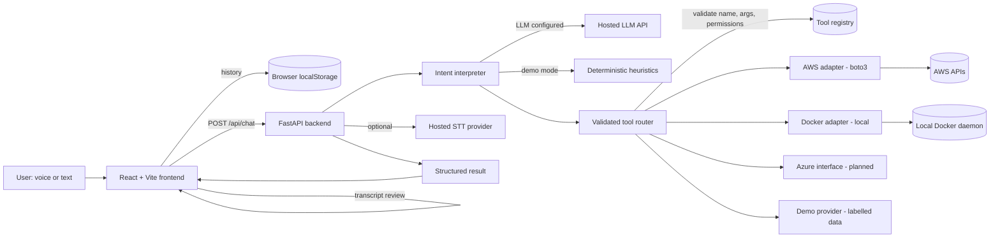
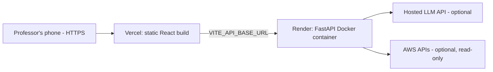

# Synthia

> **Speak to your infrastructure.**

Synthia is a cloud-hosted, voice-enabled AI assistant for cloud operations. It
handles general questions, transcribes speech, interprets natural-language
requests against a **validated tool router**, and can inspect real
infrastructure through replaceable provider adapters (AWS, Docker, Azure).
Every speech-recognition attempt — successful or failed — is recorded in a
first-class **Transcription History** for debugging.

This is a Cloud Computing mini-project. It relies on hosted services, a
remotely deployed API, containerised deployment, provider SDKs, API-based
infrastructure operations, identity/permissions, and a modular multi-cloud
architecture.

- **Repository:** synthia
- **Frontend:** React + Vite + TypeScript
- **Backend:** Python + FastAPI
- **Packaging:** Docker + Docker Compose
- **CI:** GitHub Actions

---

## 1. Project overview

Synthia lets a user speak or type a request. Voice input is transcribed by the
browser Web Speech API (or an optional hosted STT provider). The transcript is
shown **exactly as recognised** so the user can debug misheard commands and
resubmit an edited version. The backend interprets the request with an LLM
(or a deterministic heuristic in demo mode), decides whether it is general
conversation, a cloud explanation, a read-only operation, or a mutating
operation, and — for real operations — routes it through a permission-aware
tool registry. Provider adapters (AWS, Docker, Azure) execute only pre-defined,
validated operations. The LLM never gets shell access or unrestricted control.

## 2. Problem statement

Managing cloud infrastructure normally means remembering CLIs, SDKs, regions,
identifiers, and provider-specific APIs. Natural-language interfaces lower that
barrier, but they introduce two risks:

1. **Misheard commands** — speech recognition is imperfect, and acting on a
   wrong transcript can be destructive.
2. **Unsafe model output** — an LLM must not be allowed to run arbitrary
   commands or mutate infrastructure on a hunch.

Synthia addresses both: it exposes the raw transcript for review, keeps a
debuggable history of every attempt, and constrains all real actions behind a
validated, read-only-by-default tool router.

## 3. Objectives

- Provide a working end-to-end voice/text assistant for cloud operations.
- Make speech recognition failures **visible and diagnosable**, not generic.
- Route natural language through a **validated, permission-aware** tool registry.
- Integrate at least one **real** cloud provider (AWS) and one local provider
  (Docker), with an extensible interface for more.
- Run entirely in **demo mode** without paid credentials.
- Package with Docker and document public deployment (Vercel + a Docker host).
- Be usable from a phone browser over HTTPS.

## 4. Cloud computing concepts used

- **Hosted services** — the LLM and (optional) speech-to-text are network APIs.
- **Remotely deployed API** — FastAPI runs as a container on a cloud host.
- **Containerisation** — Docker images for backend (and optionally frontend).
- **Provider SDKs** — boto3 (AWS), Docker SDK for Python, Azure SDK interface.
- **API-based infrastructure operations** — resources are read via cloud APIs.
- **Identity & permissions** — the AWS credential chain, read-only IAM,
  least privilege, and bearer-token gating of real infrastructure endpoints.
- **Modular multi-cloud architecture** — provider adapters and a tool registry
  decouple the assistant from any single cloud.
- **Environment-based configuration** — twelve-factor style config and secrets.

## 5. Architecture



Request flow:

> User voice/text → speech transcription (when applicable) → transcript
> inspection → LLM interpretation → validated tool router → authorised provider
> API → structured result → assistant response **and** history.

## 6. Frontend / backend responsibilities

**Frontend (`frontend/`)**

- Conversation interface with visible current transcript.
- Voice recording lifecycle (listening / processing / success / error).
- Transcription History: search, filters, detail, copy, retry, edit+resubmit,
  clear, empty state.
- Cloud provider status and a live tool runner.
- Settings: language, recogniser, privacy, demo indicator.
- Mobile bottom navigation and responsive layout.
- **Owns V1 history** in browser `localStorage`.

**Backend (`backend/`)**

- General assistant API and streaming endpoint.
- Optional server-side STT endpoint.
- Replaceable LLM provider integration.
- Intent interpretation and validated tool routing.
- Provider adapters and a permission-aware tool registry.
- Authentication for sensitive endpoints, rate limiting, structured errors.
- Health/readiness endpoints.

## 7. Speech-recognition flow

1. The user taps the microphone (microphone permission is requested **only**
   after this interaction).
2. A provider from the `SttProvider` interface is used:
   - `browser` (**default**) — Web Speech API. Some browsers send audio to a
     vendor service; the UI warns about this.
   - `server` — records audio with `MediaRecorder` and posts it to
     `POST /api/stt/transcribe`, which forwards it to a hosted STT provider.
3. Statuses are distinct and never collapsed: `success`, `empty_transcript`,
   `permission_denied`, `unsupported_browser`, `network_failure`,
   `provider_error`, `timeout`.
4. The recognised text is displayed **verbatim** in a review strip. The user
   reviews/edits and presses send — Synthia does not silently correct a misheard
   transcript.
5. Typed input is always available and is labelled as `typed`, not as speech.

## 8. Transcription debugging & history

Each attempt records: unique event id, timestamp, exact transcript, provider,
language, input source, recognition status, confidence (only when the provider
genuinely supplies it), parsed intent, selected tool, tool status, safe error
details, and duration.

The History page provides search, all/success/failed filters, an event detail
view, copy, retry, edit-and-resubmit, clear, and an empty state. History is
stored in `localStorage` and is explicitly **local to the browser/device — it
does not synchronise across devices**. Raw audio, credentials, authorization
headers, and sensitive cloud responses are **not** stored.

## 9. LLM intent interpretation

- Configured via environment variables and replaceable
  (`LLM_PROVIDER`, `LLM_API_KEY`, `LLM_MODEL`, `LLM_BASE_URL`). Any
  OpenAI-compatible endpoint works.
- When a structured LLM is configured, it receives the tool catalogue and must
  return JSON: `{operation, tool, arguments, answer}`. Its output is advisory.
- When no key is configured, Synthia uses a **deterministic heuristic**
  interpreter and an offline demo knowledge base, so the app is fully usable in
  demo mode.
- The LLM never executes anything. It cannot claim an action succeeded; only
  the backend's tool execution result is trustworthy.

## 10. Cloud tool router & provider adapters

Every tool has a name, description, JSON argument schema, required permissions,
provider, read-only/mutating classification, and an execution function.

The backend independently rejects: unknown tools, invalid arguments (Pydantic,
extra keys forbidden), unavailable providers, unauthorised requests, and
out-of-scope operations. Handlers are the only code that runs.

| Provider | Status | Notes |
| --- | --- | --- |
| **AWS** (boto3) | Implemented, unit-tested with mocks | Read-only: list/describe EC2, list S3. Live use requires credentials. |
| **Docker** (SDK) | Implemented, unit-tested with mocks | Read-only: list/inspect containers, bounded logs. Local only; disabled in production. |
| **Azure** | Interface + config only | Reported honestly as planned/unconfigured. No live operations. |
| **Demo** | Implemented & verified | Labelled sample data; never a real mutation. |

## 11. Docker packaging

- `backend/Dockerfile` — Python 3.13 slim, non-root, binds `0.0.0.0`, honours
  `$PORT`, includes a healthcheck.
- `frontend/Dockerfile` — multi-stage Node build → nginx, with SPA fallback.
- `compose.yaml` — runs both with `docker compose up --build`.

## 12. Deployment architecture



- **Frontend → Vercel.** Set `VITE_API_BASE_URL` to the backend URL in Vercel's
  build settings. No `localhost` is hardcoded in production code.
- **Backend → Render (or any Docker host).** The image binds `0.0.0.0`, respects
  `PORT`, and reads all config from environment variables.
- **CORS** is restricted to configured origins via `CORS_ALLOWED_ORIGINS`.

> Free hosting may sleep, restart, or rate-limit. Do not assume always-on or
> unlimited free infrastructure.

## 13. Security & limitations

**Implemented**

- Read-only cloud tools by default (`ALLOW_MUTATING=false`).
- Mutating tools require both `ALLOW_MUTATING=true` and explicit confirmation.
- Bearer-token gating of cloud execution and server history when
  `API_AUTH_TOKEN` is set.
- No arbitrary shell execution; the LLM cannot run commands.
- Docker access disabled in production environments.
- Structured error responses that never leak stack traces or secrets.
- Simple in-memory rate limiting; request size/length limits.
- No secrets in the frontend; only connection *status* is exposed.

**Verified vs. requires credentials**

| Feature | Verified | Requires credentials/config |
| --- | --- | --- |
| Demo mode, tool routing, history, tests | ✅ | — |
| LLM answers | Demo only | Hosted LLM key for live answers |
| Browser speech recognition | Implemented | A supported browser + HTTPS |
| Hosted STT | Implemented | `STT_PROVIDER` + key |
| AWS read-only ops | Mocks + unit tests | AWS credentials (read-only) |
| Docker read-only ops | Mocks + unit tests | Local Docker daemon |
| Azure | Interface only | Not implemented |

**Known limitations (not claimed)**

- No Kubernetes orchestration, high availability, or cloud-native autoscaling.
- Not a working multi-cloud control plane: only AWS and Docker are real; Azure
  is an interface.
- In-memory server history is ephemeral and non-authoritative.
- Rate limiting is per-instance, not distributed.
- Browser speech recognition behaviour varies across browsers and is not
  promised to work identically on all mobile browsers.

## 14. Installation & local execution

### Backend

```bash
cd backend
python3 -m venv .venv
source .venv/bin/activate
pip install -r requirements-dev.txt
cp ../.env.example .env          # optional; defaults run in demo mode
uvicorn app.main:app --reload --port 8000
```

Open `http://localhost:8000/docs` for the OpenAPI docs.

### Frontend

```bash
cd frontend
npm install
cp .env.example .env             # optional; empty API base uses the dev proxy
npm run dev                      # http://localhost:5173
```

The Vite dev server proxies `/api`, `/health`, and `/ready` to
`http://localhost:8000` (override with `VITE_DEV_BACKEND`).

## 15. Environment variables

See `.env.example` (backend) and `frontend/.env.example`. Key variables:

| Variable | Purpose |
| --- | --- |
| `APP_ENV`, `PORT`, `DEMO_MODE` | Runtime basics |
| `CORS_ALLOWED_ORIGINS` | Allowed frontend origins |
| `API_AUTH_TOKEN` | Bearer token for protected cloud operations |
| `ALLOW_MUTATING` | Opt in to mutating tools (default false) |
| `RATE_LIMIT_PER_MINUTE` | Per-instance rate limit |
| `LLM_PROVIDER`, `LLM_API_KEY`, `LLM_MODEL`, `LLM_BASE_URL` | LLM configuration |
| `STT_PROVIDER`, `STT_API_KEY`, `STT_MODEL`, `STT_BASE_URL` | Server STT (optional) |
| `AWS_ENABLED`, `AWS_DEFAULT_REGION`, `AWS_ACCESS_KEY_ID`, `AWS_SECRET_ACCESS_KEY` | AWS |
| `DOCKER_ENABLED`, `DOCKER_SOCKET` | Local Docker |
| `AZURE_ENABLED`, `AZURE_SUBSCRIPTION_ID` | Azure (planned) |
| `VITE_API_BASE_URL`, `VITE_STT_PROVIDER` | Frontend build-time |

The API token is **not** a build-time variable: it is entered at runtime in the
Settings page and stored in `sessionStorage` only, so it is never bundled into
the JavaScript.

Never commit a real `.env`, key, or token.

## 16. Cloud provider configuration

**AWS (read-only).** Enable with `AWS_ENABLED=true` and `AWS_DEFAULT_REGION`.
Provide credentials via the standard boto3 chain (IAM role preferred, or
environment variables). Minimal policy:
`ec2:DescribeInstances`, `s3:ListAllMyBuckets`.

**Docker (local demo).** Enable with `DOCKER_ENABLED=true` on a trusted machine
where the socket is reachable. It is forced off in production.

**Azure.** Interface and configuration model only. It is reported as
unconfigured/planned; no live operation is implemented or verified.

## 17. Testing

```bash
# Backend (mocks; no paid resources)
cd backend && pip install -r requirements-dev.txt && python -m pytest

# Frontend
cd frontend && npm ci && npm run test && npm run lint && npm run build

# Environment doctor: verify every env var / integration is wired up
cd backend && python debug.py          # safe local checks (no network)
cd backend && python debug.py --live   # also ping the configured LLM/AWS/Docker
cd backend && python debug.py --json   # machine-readable
```

`debug.py` prints one line per setting and integration with `OK`/`WARN`/`FAIL`
(reporting the actual failure reason), masks secrets, and exits non-zero if any
required check fails. It is the fastest way to confirm a fresh checkout or deploy
is configured correctly.

The backend suite (57 tests) covers health/readiness, validation, assistant
routing, tool routing, unknown tools, invalid arguments, missing credentials,
provider errors, AWS/Docker adapters (mocked), transcription event creation and
distinct failure statuses, and confirmation requirements for mutating
operations. Frontend tests cover history persistence/filtering, status mapping,
and transcript/error rendering.

## 18. Public demo URL

> **Placeholder:** `https://synthia-demo.example.com`
> Replace with your Vercel URL after deployment. The backend runs on Render (or
> another Docker host); set `VITE_API_BASE_URL` to that URL at build time.

## 19. Future scope

- Additional providers and Kubernetes: GCP, Kubernetes, monitoring/deployment
  platforms, using the existing adapter interface.
- Approval workflow UI for real mutating operations.
- Durable, authenticated server-side history (opt-in) with retention controls.
- PWA offline shell and richer auth (OAuth) for shared deployments.
- Distributed rate limiting and structured audit logging.

---

### Why this is a Cloud Computing project, not only an ML project

Synthia is not a locally trained model. It is a distributed system composed of
a remotely deployed containerised API, a static frontend on a CDN, hosted LLM
and speech APIs, cloud provider SDKs, API-based infrastructure operations,
identity and permission boundaries, and an extensible multi-cloud adapter
layer. The value is in the cloud integration, deployment, and safe API
orchestration — the ML component is a replaceable, externally hosted service.

### Final status snapshot

- Backend: **57/57 tests pass**; runs locally and in Docker. `debug.py` reports
  all env vars/integrations and exits non-zero on misconfiguration.
- Frontend: **typechecks, 10/10 tests pass, production build succeeds**.
- Live cloud calls require credentials; demo mode works without any.
- Remaining blocker for a public mobile demo: deploy the backend and set
  `VITE_API_BASE_URL` + `CORS_ALLOWED_ORIGINS`, then open the HTTPS URL on a
  phone (typed input works everywhere; browser microphone support varies).
